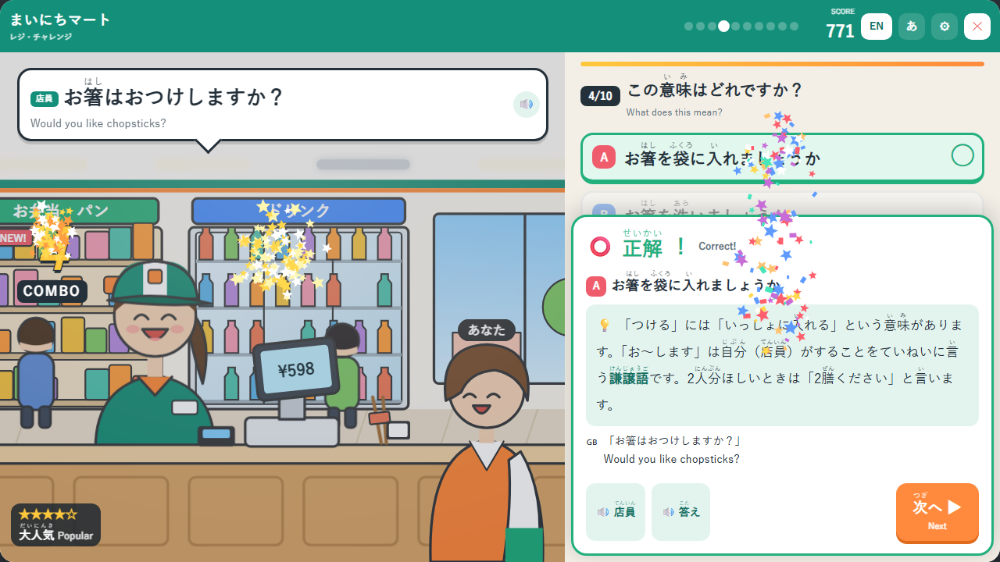

# まいにちマート レジ・チャレンジ
### N3コンビニ日本語クイズ（全10問） / N3 Konbini Japanese Quiz



コンビニのレジで、店員さんがよく使う日本語を聞き取るクイズゲームです。
4つの選択肢から正しい答えを選びましょう。連続で正解すると、お店がどんどんにぎやかになります。

A quiz game to learn the Japanese that convenience store clerks really use.
Listen to the clerk and choose the right answer. Get answers right in a row to make the store busier!

一款在便利店收银台学习日语的小游戏。听店员说的话，从4个选项中选出正确答案。

---

## ▶ あそぶ / Play

https://yasu-fumi.github.io/N3-Convenience-Store-Quiz-01/

スマートフォン・パソコンのどちらでも遊べます（Chrome / Edge / Safari 推奨）。

## 特長 / Features

- 🏪 コンビニのレジが舞台。正解・不正解で店員さんの表情が変わる
- 🔥 コンボで店内が明るくなり、商品とお客さんが増える（5段階）
- 🌐 翻訳：English / 中文 / नेपाली（プレイ中に切り替え可能）
- あ ふりがな表示の ON / OFF
- 🔊 声・効果音・BGM の音量をそれぞれ調節
- 📖 各問題に日本語の解説つき
- ⌨ PC はキーボード操作に対応（1〜4 / A〜D で選択、Enter で次へ、Esc でメニュー）

## 収録している表現 / Expressions

| # | 店員のことば | 学べること |
|---|---|---|
| 1 | お弁当は温めますか？ | 温める |
| 2 | レジ袋はご利用ですか？ | ご利用＝使う |
| 3 | ポイントカードはお持ちですか？ | 尊敬語「お持ち」 |
| 4 | お箸はおつけしますか？ | 謙譲語「お〜します」 |
| 5 | こちらでお召し上がりですか？ | 尊敬語「召し上がる」 |
| 6 | 1,000円お預かりします。 | お金を受け取るとき |
| 7 | 画面の年齢確認ボタンを押してください。 | 20歳以上の確認 |
| 8 | （いいえ、）大丈夫です。 | 断るときの「大丈夫」 |
| 9 | お会計、850円になります。 | 「〜になります」 |
| 10 | 少々お待ちください。 | 「少々」「お待ちください」 |

## ファイル構成 / Files

```
index.html     ゲーム本体（問題・イラスト・効果音・BGM をすべて含む1ファイル）
voice/         店員の声・回答の音声（MP3 / WAV）を入れるフォルダ
screenshot.png この README 用の画像
```

外部のライブラリやサーバーは使っていません。`index.html` を開くだけで動きます。

## 声の差し替え / Voice files

`voice/` フォルダに決まった名前の MP3 または WAV を置くと、自動でその音声が使われます。
ファイルがない場合は、ブラウザの音声合成で読み上げます。
ファイル名と読む文の一覧は [voice/README.txt](voice/README.txt) を見てください。

## 問題の編集 / Editing

`index.html` の中の `const QUIZ = [ ... ]` を編集します。ふりがなは `{漢字|かんじ}` と書きます。

---

© まいにちマート レジ・チャレンジ
